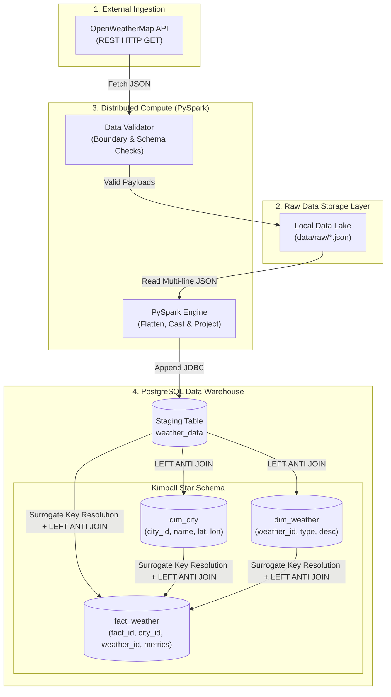
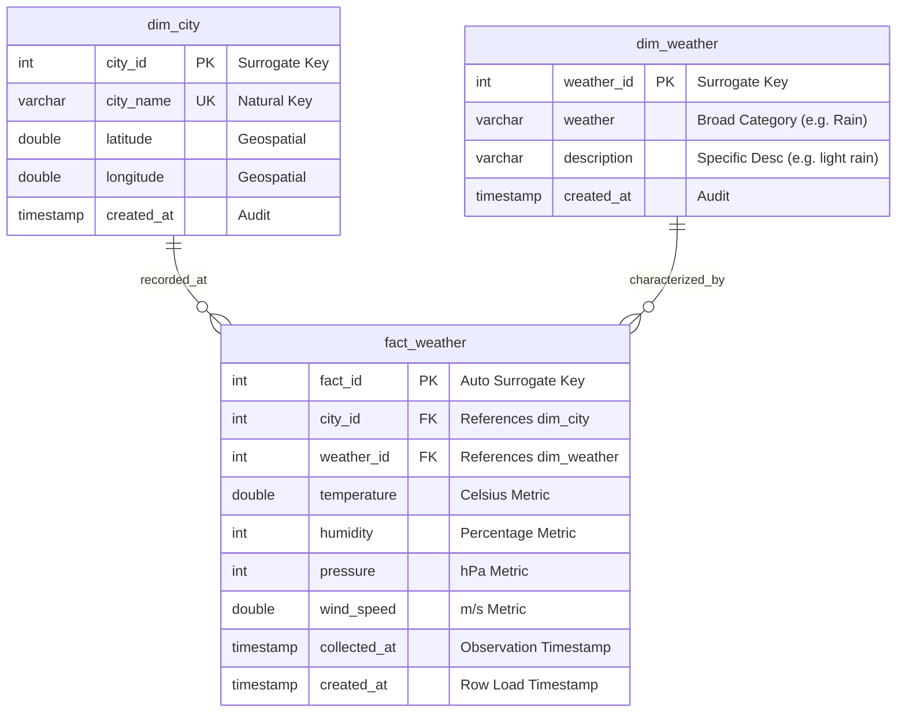

# 02. Architecture and Design

## System Architecture Overview

The system implements a classic **Modern Data Warehouse (MDW)** pattern adapted for streaming/micro-batch API telemetry. It consists of five decoupled layers: Ingestion, Raw Storage Lake, Compute Transformation, Staging Layer, and Dimensional Warehouse.

---

## Detailed Layer Architecture

### Layer 1: Ingestion & Telemetry Acquisition (`extract.py`)
- **Protocol**: HTTP/1.1 REST over TLS (`https://api.openweathermap.org/data/2.5/weather`).
- **Resilience**: Configured with explicit socket timeouts (10 seconds), automatic retry handling, and targeted exception logging (`RequestException`, `HTTPError`).
- **Auditability**: Every successful payload is persisted to `data/raw/{city}_{timestamp}.json` with ISO-8601 timestamps, allowing replayability in case of downstream failures.

### Layer 2: Pre-Ingestion Data Validation (`validator.py`)
- Acts as a defensive gatekeeper before disk persistence.
- Enforces strict geospatial bounds (Latitude $\in [-90, 90]$, Longitude $\in [-180, 180]$).
- Enforces physical atmospheric constraints (Relative Humidity $\in [0, 100]\%$, Pressure $> 0 \text{ hPa}$, Wind Speed $\ge 0 \text{ m/s}$).

### Layer 3: Transformation Engine (`transform.py`)
- Powered by **Apache Spark (PySpark)** running local multi-threaded workers (`local[*]`).
- Reads raw multi-line JSON with schema inference or explicit field projection.
- Extracts deeply nested fields:
  - `coord.lat` $\rightarrow$ `latitude` (`DoubleType`)
  - `coord.lon` $\rightarrow$ `longitude` (`DoubleType`)
  - `main.temp` $\rightarrow$ `temperature` (`DoubleType`)
  - `main.humidity` $\rightarrow$ `humidity` (`IntegerType`)
  - `main.pressure` $\rightarrow$ `pressure` (`IntegerType`)
  - `wind.speed` $\rightarrow$ `wind_speed` (`DoubleType`)
  - `weather[0].main` $\rightarrow$ `weather` (`StringType`)
  - `weather[0].description` $\rightarrow$ `description` (`StringType`)

### Layer 4: Staging Persistence (`load.py`)
- Writes clean columnar dataframes to PostgreSQL `weather_data` staging table using Spark JDBC driver (`org.postgresql.Driver`).
- Uses `append` mode with connection pooling.
- Preserves high-throughput ingestion decoupled from warehouse dimensional modeling.

---

## Dimensional Modeling (Kimball Star Schema)

The warehouse follows standard Kimball dimensional design optimized for analytical query efficiency:

---

## Idempotency & Incremental Loading Engine

A critical challenge in data engineering is re-running failed jobs without corrupting dimensions or producing duplicate facts.

### 1. Dimension Loading (`dim_city.py` & `dim_weather.py`)
The pipeline implements an **SCD Type 1 (Slowly Changing Dimension)** with incremental discovery:
1. Extract unique natural keys from the latest staging batch.
2. Read the existing target dimension table from PostgreSQL via Spark JDBC.
3. Perform a **`LEFT ANTI JOIN`** between the batch and existing dimension records:
   $$\text{NewRecords} = \text{Batch} \setminus \text{ExistingDimension}$$
4. If $\text{Count}(\text{NewRecords}) = 0$, skip write entirely.
5. If new entities are found, append them to PostgreSQL, where auto-incrementing serial sequences generate surrogate keys (`city_id`, `weather_id`).

### 2. Fact Table Resolution & Loading (`fact_weather.py`)
1. Joins staging rows with `dim_city` on `city == city_name` to obtain `city_id`.
2. Joins staging rows with `dim_weather` on `weather` and `description` to obtain `weather_id`.
3. Performs a `LEFT ANTI JOIN` against existing `fact_weather` records matching `(city_id, weather_id, collected_at)`.
4. Appends only truly novel observations to `fact_weather`.

---

## Reliability & Fault Tolerance Strategy

| Failure Scenario | Built-in Mitigation |
| :--- | :--- |
| **API Outage / 5xx error** | Captured in `extract.py` with error logging; remaining cities continue uninterrupted. |
| **Corrupt JSON response** | Checked by `validator.py`; malformed payloads fail before writing to lake. |
| **Pipeline rerun / duplicate execution** | `LEFT ANTI JOIN` in dimensions and fact table prevents duplicate records. |
| **Database Connection Failure** | Centralized in `scripts/warehouse/database.py` with clear JDBC connection exceptions. |
| **Windows Pathing Issues** | Dynamic `Path.resolve()` for JDBC jar handles Windows backslashes and Linux forward slashes transparently. |
